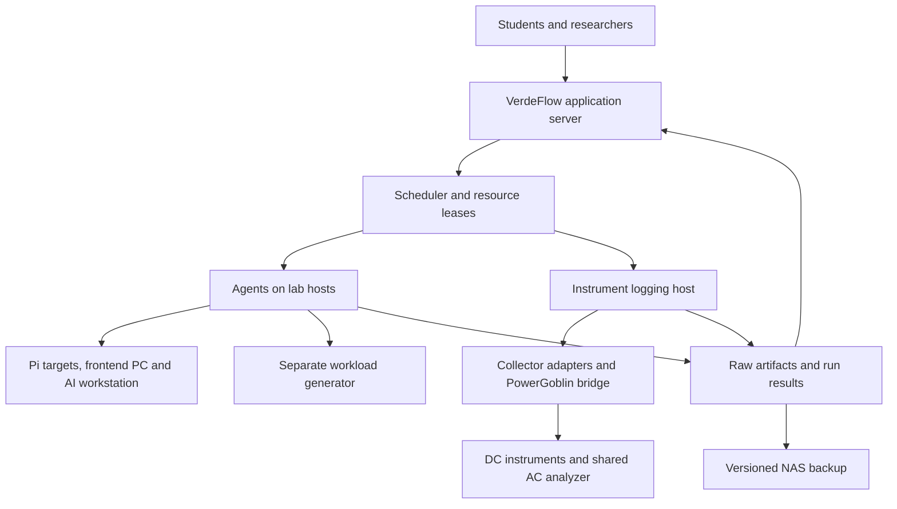

# VerdeFlow Physical Measurement Lab Specification

Version: 1.0
Baseline date: 4 November 2026
Owner: LUT Sustainable Software research team
Purpose: Reference specification for auditing the current VerdeFlow codebase against the intended lab.

## 1. How Codex should use this document

This document describes the **target lab and required software behaviour**, not capabilities verified in the current repository. No codebase audit has been performed while preparing it.

1. Read the repository's applicable `AGENTS.md`, architecture documentation, manifests, deployment configuration and existing tests.
2. Discover the actual language, framework, database, job queue, agent and frontend. Do not assume Rails, Node, Vue or any earlier proposed stack.
3. Map each requirement ID below to concrete code, configuration, tests and user-visible behaviour.
4. Produce the audit report described in section 14 before proposing implementation work. Do not rewrite the application or add frameworks merely to resemble this specification.
5. Distinguish working implementations from interfaces, placeholders, mocks and documentation claims. A dashboard or device table alone does not establish a working physical measurement workflow.
6. Treat missing hardware access as **unverified**, not as proof that an integration works or fails.
7. Preserve existing useful functionality. Recommend the smallest coherent changes that meet the requirements.

Requirements use these priorities:

| Priority | Meaning |
|---|---|
| P0 | Needed before operating the shared remote physical measurement lab reliably. |
| P1 | Needed for the intended research and teaching service; may follow the initial end-to-end workflow. |
| P2 | Extension after the physical measurement workflow is established. |

`MUST` means required target behaviour. `SHOULD` means recommended behaviour; the audit may propose a justified alternative. Logical entities and example contracts are design guidance, not mandatory database table or API names.

## 2. Lab purpose and scope

Build a fixed-location physical lab that students and researchers can access remotely through VerdeFlow. Workloads execute on real devices and energy measurements come from physical meters or explicitly identified software collectors. Users should not need to move the equipment between classrooms.

VerdeFlow is the interface and orchestration layer: experiment submission, device discovery, booking, queueing, deployment, execution, collection, provenance, analysis and results. The intended collaboration with the University of Turku is to reuse or integrate suitable PowerGoblin components behind collector adapters. **PowerGoblin integration is a target, not an already-confirmed implementation.**

The initial research workloads include API profiling, comparison of software variants and commits, frontend/browser experiments, and AI inference or other high-load compute experiments. Examples from the research programme include PetClinic API variants and load generation with k6; these are examples, not an exclusive workload format.

Boundaries:

- Keep application hosting, load generation, instrument acquisition and measured workloads on their assigned hosts so their energy costs are not accidentally mixed.
- Treat the ten Raspberry Pis as ten physical targets. A distributed cluster is one possible experiment, not a requirement that every run use all ten.
- Support heterogeneous devices and tools. Do not make PowerJoular, RAPL, Joulescope, Otii or PowerGoblin a universal prerequisite for every run.
- Keep the lab measurement-first. Carbon estimates, if added, must be derived and labelled separately from measured energy.

## 3. Evidence and planning status

The hardware baseline comes from the user's equipment photographs and quantities, plus the reviewed VerdeFlow purchase list. Photographs establish visible labels and ownership context, not calibration, operating limits, driver compatibility or functioning integration.

Procurement baseline: **EUR 38,585.31 including VAT**, excluding shipping, with EUR 1,414.69 below EUR 40,000. Eighteen rows have matching published product prices; fourteen remain provisional allowances. Prices are a dated planning snapshot, not current quotations. The server budget remains below EUR 2,500 and the AI workstation budget approximately EUR 6,000.

Source purchase document: [VerdeFlow Lab Purchase List](https://chatgpt.com/library?file_id=libfile_cb7a64e10d3c8191affc7a07586e9757&account_id=c9ccba6f-97f2-4e8f-ab23-02bab035e2a1).

The original attached procurement spreadsheet was unavailable during preparation. This specification does not claim to have read that attachment. Do not treat a procurement entry as proof that a device has been ordered, delivered or commissioned.

## 4. Equipment already owned

| Equipment | Established quantity | Intended role and remaining verification |
|---|---:|---|
| ODROID-labelled SmartPower3 units | 3, stated by user; box labelled SmartPower3 | Existing DC power measurement resources. These are not three confirmed ODROID compute boards. Record actual channels, limits and host interface from the units/documentation before enabling them. |
| Switching adapters | 3 | Photographed label states 19 V, 7 A, 133 W. Map each adapter to its intended instrument. Do not infer that it is suitable for Otii, Pi or any other device. |
| Joulescope JS220 | At least 1 identifiable in photographs | Existing DC measurement instrument. Repeated photographs do not establish additional units. Confirm count, serial, limits, calibration and driver. |
| Otii Arc, box labelled Otii Arc Pro | At least 1 identifiable in photographs | Existing DC instrument. Confirm exact model/revision and software entitlement from inventory. Do not count the box and instrument separately. |
| USB cables, DC leads and accessory wires | Assorted; exact count unconfirmed | Reuse after checking type, polarity, rating and condition. Existing accessories do not establish a complete connection kit for every target. |

Existing ownership does not establish automation licences, compatible firmware, unattended operation or a sufficient power envelope for a Pi 5 at full configured load.

## 5. Planned purchases and their roles

All entries below are **planned**, not confirmed installed equipment. Final models and configurations remain subject to quotation and compatibility checks.

| Equipment | Planned quantity | Lab role or scope |
|---|---:|---|
| Raspberry Pi 5, 16 GB | 10 | Identical ARM API/edge targets. |
| Official 27 W EU Pi power supplies | 12 | Ten setup/reference supplies plus two spares. |
| Official Pi active coolers | 12 | Ten installed plus two spares. |
| SC1676 512 GB SSD and M.2 HAT+ kits | 12 | Ten target storage assemblies plus two complete spares. |
| Pi mounting/enclosure set | 1 complete set | Capacity for at least twelve Pi/HAT/cooler assemblies; complete fit is unquoted. |
| SanDisk 64 GB recovery microSD cards | 12 | Ten recovery images plus two spares. |
| Transcend RDF5 card readers | 2 | Prepare and restore recovery media. |
| VerdeFlow application server | 1 | Linux, 8-core-class CPU, 32 GB RAM, mirrored 2 x 1 TB NVMe, 1 GbE; expandable RAM target. Approx. EUR 2,400 configured allowance. |
| AI/heavy-compute workstation | 1 | Core Ultra 9/Ryzen 9 class, 64 GB RAM, RTX 5080 16 GB reference, 2 TB NVMe plus target extra 2 TB storage, compatible 10 GbE and Linux. Complete budget EUR 6,000. |
| Workload generator | 1 | Separate 12–16-core-class x86 host, 64 GB RAM, 1 TB SSD, 10 GbE; configuration unquoted. |
| Instrument logging host | 1 | Dedicated Linux x86 host, 32 GB RAM, 2 TB SSD and adequate USB connectivity for collectors and possible PowerGoblin integration. |
| Frontend measurement PC | 1 | Separate x86 browser target, 32 GB RAM, 1 TB SSD. |
| Otii Ace Pro reference instruments | 2 | Additional higher-current DC measurement paths; rated sustained load, external supply and interface design must be confirmed. |
| Matched DC instrument power supplies | 2 | Supplier-approved supplies for the new instruments, unless already included. |
| DC measurement connection kits | 10 | Rated leads, connectors, protection and compatible Pi input interfaces; complete design and parts list unquoted. |
| Automation Toolbox perpetual entitlement | 1 planned entitlement | Licence scope and concurrent use require confirmation; not one assumed entitlement per instrument. |
| AC power analyzer package | 1 | WT310E-class reference, with logging, calibration and enclosed mains fixture; complete package unquoted. Shared across AC experiments. |
| Powered seven-port USB hubs | 2 | Instrument data connections; external supplies included. Not Pi power supplies. |
| Instrument USB data cables | 15 | Connector mix and spares to match actual devices; allowance, not fifteen confirmed identical cables. |
| Managed switch | 1 | SG3428X reference: 24 x 1 GbE plus 4 x 10 GbE SFP+ uplinks. |
| 10 GbE link kits | 3 | Two active links plus a spare; match workstation/load-generator NICs and switch. NICs remain within PC configuration budgets. |
| Cat6 patch leads | 25 | Reviewed price uses a specific 2 m cable; final length distribution may differ. |
| Network-switched eight-outlet PDUs | 2 | AP7920B reference; remote power control, subject to outlet mapping and control policy. |
| Controller/server/storage UPS | 1 | Eaton 1500 VA / 1500 W reference; size for actual server/controller/NAS/network load. |
| DS925+ diskless NAS | 1 | Backup storage, separate from primary application and acquisition storage. |
| HAT3320-8T 8 TB NAS disks | 4 | RAID 10 target: about 16 TB decimal usable before filesystem overhead; confirm NAS compatibility. |
| Ambient logger and suitable probe | 1 package | Room/environment metadata. Complete package remains provisional. |
| Shared 23.8-inch monitor | 1 | Console use and selected frontend/display experiments. |
| Keyboard and mouse set | 1 | Shared local console. |
| KVM/display adapter package | 1 | Local console switching; complete cable/adapter set unquoted. |
| CEE 7/7 to C13 mains cord, 1 m | 1 | One specific cable only. Additional UPS/PDU leads and socket adapters are not covered by this quantity. |
| Spares and assembly supplies | 1 mixed allowance | PCIe ribbons, mounting parts, labels and ESD supplies; parts list unquoted. |

There is no separately budgeted GPU-workstation UPS or new general server rack in the current plan. Use existing bench/shelving with suitable ventilation. The Pi enclosure set above is a separate item.

## 6. Physical and logical architecture

The diagram shows control and data relationships, not electrical wiring. Instrument USB connections terminate on the logging host or an explicitly configured acquisition host. Ethernet connects hosts to the managed lab switch. The workstation and load generator are intended to use the two active 10 GbE links.

### DC measurement path

A validated supply/instrument/interface arrangement powers the target through the measurement boundary. The logging host controls acquisition independently of the target. Where an instrument both supplies and measures power, its output is the target supply; where a meter measures an external supply, its documented connection arrangement applies.

Do not prescribe a universal wiring diagram for all meters. Record each commissioned path, including auxiliary power, USB back-power risks, peripherals and excluded components. Do not connect independent target supplies simultaneously without an approved arrangement. Remote users select commissioned paths; they do not enter arbitrary voltage or wiring settings.

### AC measurement path

The enclosed AC fixture measures the complete selected load at its defined mains boundary. Examples: AI workstation including its PSU losses, or frontend PC. The monitor may be included or excluded according to the declared experiment boundary. The single AC analyzer is shared and cannot support independent simultaneous AC experiments unless future verified channels permit this.

PDUs provide switching; a PDU or UPS must not automatically be treated as a research-grade per-target energy meter. Measure any infrastructure consumption under its own boundary.

## 7. Resource registry and capacity

| ID | Priority | Required behaviour |
|---|---|---|
| LAB-REG-01 | P0 | Register physical hosts, devices under test, instruments, individual measurement channels, acquisition hosts and power outlets as distinct resources with stable IDs. |
| LAB-REG-02 | P0 | Track planned, commissioning, available, reserved, running, offline, maintenance and quarantined states as appropriate. Planned equipment cannot receive live jobs. |
| LAB-REG-03 | P0 | Describe capabilities: architecture, OS, CPU/RAM/GPU, available collectors, voltage/current/power envelope, sample capabilities, calibration metadata and physical boundary. Unknown limits must remain unknown. |
| LAB-REG-04 | P0 | Bind a target to a commissioned measurement path: instrument/channel, acquisition host, approved supply/interface and relevant outlet. Refuse incompatible or uncommissioned paths. |
| LAB-REG-05 | P0 | Calculate usable concurrency from actual compatible resources, not target count. Ten Pis do not imply ten independent simultaneous measured runs. |
| LAB-REG-06 | P1 | Keep versioned configuration snapshots, serial/model/firmware details and maintenance history so old runs retain their original hardware context. |

Use logical names such as `pi-01` through `pi-10`, `ai-01`, `frontend-01`, `loadgen-01` and `logger-01` as examples only. Do not invent IP addresses, credentials, instrument serials or outlet mappings.

Default to one exclusive experimental reservation per physical target. Concurrent containers on a host do not provide independent whole-device energy attribution. A multi-Pi experiment reserves every participating device and required measurement resource as one allocation.

## 8. Collector and agent design

| ID | Priority | Required behaviour |
|---|---|---|
| LAB-COL-01 | P0 | Use a measurement-tool-agnostic collector contract. Keep vendor transport and parsing outside core experiment orchestration. |
| LAB-COL-02 | P0 | Support capability discovery, configuration validation, preparation, acquisition start/stop, health/error reporting and artifact retrieval, or equivalent lifecycle operations. |
| LAB-COL-03 | P0 | Preserve raw output and normalize samples/aggregates with explicit units, timestamps, source, boundary and quality. Preserve source semantics when formats differ. |
| LAB-COL-04 | P0 | Allow collectors to run off-target on the logging host. Agent identity, target identity and instrument identity must not be conflated. |
| LAB-COL-05 | P0 | Support acquisition failure, missing samples, reconnects and partial uploads without silently returning zero energy or a successful measurement. |
| LAB-COL-06 | P1 | Provide physical collector adapters for selected existing/new instruments. Each must declare supported models/versions and commissioning evidence. |
| LAB-COL-07 | P1 | Provide a PowerGoblin integration boundary through its actual supported API, CLI or output files after inspecting the agreed Turku version. Do not invent its protocol or instrument support. |
| LAB-COL-08 | P1 | Accommodate software sources such as RAPL/PowerJoular and GPU telemetry where supported; label their scope separately from external physical measurement. |
| LAB-COL-09 | P2 | Extend through the same conceptual contract to cloud/Kubernetes metrics, LLM logs and agent events. These extensions must not delay the physical lab workflow. |

An illustrative contract is `discover -> validate -> prepare -> start -> collect -> stop -> finalize`. Equivalent existing code is acceptable. Always attempt bounded cleanup after a failed preparation or acquisition step. Do not require a streaming interface when a device only provides a final file or cumulative counter.

An agent SHOULD advertise version and capabilities, authenticate to the control service, report heartbeats, execute only assigned jobs and upload idempotently. Device-specific elevated privileges must be scoped to the local operation that needs them rather than granted to the web application.

## 9. Experiment lifecycle and scheduling

Target lifecycle: `submitted -> queued -> allocating -> preparing -> warming_up -> measuring -> finalizing -> completed`. Terminal alternatives include `failed` and `cancelled`; an interrupted job must be reconciled after restart. Implementations may use equivalent names, but must preserve the distinctions.

| ID | Priority | Required behaviour |
|---|---|---|
| LAB-RUN-01 | P0 | Create a run manifest identifying repository/project, exact commit or source artifact, build/image digest when applicable, workload definition, parameters, targets, collectors and requested boundary. |
| LAB-RUN-02 | P0 | Validate capabilities and reserve the full resource set before deployment: target, instrument/channel, load generator, acquisition resources and controlled outlets as needed. |
| LAB-RUN-03 | P0 | Enforce reservations atomically on the server. UI-only booking or process-local locks are insufficient across workers/restarts. |
| LAB-RUN-04 | P0 | Use leases/fencing or an equivalent durable ownership mechanism, heartbeats, bounded timeouts and recovery. A lost lease does not make an unreachable running target safe to reuse. |
| LAB-RUN-05 | P0 | Perform readiness checks, controlled warmup, acquisition start acknowledgement and a marked measurement window. Retain workload outcomes and acquisition outcomes separately. |
| LAB-RUN-06 | P0 | Stop workloads and collectors, finalize available artifacts and release or quarantine resources on success, timeout, failure and cancellation. A redelivered job must not launch duplicate workloads. |
| LAB-RUN-07 | P0 | Keep load generation off the measured target unless collocation is explicitly part of the experiment boundary. Record generator identity and its achieved load. |
| LAB-RUN-08 | P1 | Support bookings, an execution queue, fair access, quotas and visibility of resource contention. A booking and an active execution lease are different concepts. |
| LAB-RUN-09 | P1 | Support repeated runs, warmup exclusion, cooldown, seeded random order and recorded conditions for comparing software variants. |
| LAB-RUN-10 | P1 | Link results to Git commits/PRs or CI runs with authenticated, idempotent submission and stable result URLs. |

Workflow: user selects project/commit and experiment template; VerdeFlow validates and queues; scheduler leases compatible resources; agents deploy exact artifacts and prepare hosts; logger prepares the meter; warmup finishes; measurement and workload windows are coordinated; results/artifacts are finalized; resources are cleaned and released; dashboard displays results with provenance and quality.

Host failure or a completed workload without usable acquisition must not produce a green "successful measurement" result.

## 10. Results and research validity

| ID | Priority | Required behaviour |
|---|---|---|
| LAB-DATA-01 | P0 | Keep raw artifacts, normalized measurements, run metadata, workload outcomes and quality indicators linked by a stable run ID. |
| LAB-DATA-02 | P0 | Persist energy in joules and power in watts with explicit source units/conversions. Counter resets, wraps and missing values need handling appropriate to the collector. |
| LAB-DATA-03 | P0 | Record measurement boundaries explicitly: whole-system AC, target DC input, CPU/package domain, GPU telemetry or another declared scope. Do not add overlapping sources as though they were disjoint energy components. |
| LAB-DATA-04 | P0 | Record start/end times, duration, clock source/alignment, units and sample coverage or equivalent integrity evidence. Unknown uncertainty/coverage must not be reported as zero uncertainty/full coverage. |
| LAB-DATA-05 | P0 | Distinguish raw, derived, estimated, simulated and imported values. Synthetic replay data must never appear as commissioned physical measurements. |
| LAB-DATA-06 | P1 | Report workload-normalized metrics, latency/throughput/errors and repeated-run summaries, with denominators and experiment windows recorded. |
| LAB-DATA-07 | P1 | Export CSV/JSON plus a reproducibility manifest and raw-artifact references. Results must remain interpretable outside the dashboard. |
| LAB-DATA-08 | P1 | Version calculation methods and preserve original results when processing or collector implementations change. |
| LAB-DATA-09 | P2 | For carbon estimates, store intensity value, units, region, time basis, source and method; distinguish operational energy-derived estimates from embodied impacts. |

Calculation guidance:

- For power samples, integrate over their actual time intervals using a documented method; do not assume constant sample spacing when timestamps show otherwise.
- For cumulative energy counters, use the appropriate delta with reset/wrap detection. Do not integrate an energy counter as though it were power.
- `energy_per_successful_request_j = measured_energy_j / successful_requests` is valid only for the same window and boundary. Define failed requests and return unavailable when the denominator is zero.
- For AI runs, record model/version or digest, runtime, precision/quantization, input and output size, batching, concurrency, duration and successful work count. Joules per inference/token require an explicit matching denominator and boundary.
- Record idle/baseline measurements separately. Any baseline-subtracted result must identify the method and retain the gross measurement; do not silently clip negative adjusted values to zero.
- RAPL CPU/package-domain data, GPU telemetry and wall-socket energy answer different questions. Agreement is not assumed, and correlations alone do not establish measurement accuracy.
- A Pi measurement may include its SSD and cooling if they are within its powered boundary; document any independently powered peripheral outside that boundary.
- Store CPU policy, thermal conditions, relevant power limits, software versions and background-load controls where available. Uncontrolled or unknown conditions must be visible.

## 11. Logical data model

Map these concepts to existing models/services rather than automatically creating a table per row.

| Concept | Minimum information |
|---|---|
| Organisation/project/access grant | Ownership, members/roles, allowed devices, data visibility and quotas. |
| Host/target | Stable identity, role, hardware/OS capabilities, agent identity, readiness and maintenance state. |
| Instrument/channel | Model/serial, acquisition host, driver, capabilities, calibration and availability. |
| Measurement path | Target, instrument/channel, supply/interface, outlet association, boundary and commissioning status. |
| Experiment specification | Immutable/versioned workload, source revision, parameters, requested resources and collection plan. |
| Booking/resource lease | Owner, resource set, interval/expiry, durable execution ownership and fencing/recovery information. |
| Run/attempt | Logical run ID, attempt ID, lifecycle timestamps, allocated resources, execution outcome and measurement outcome. |
| Measurement series/summary | Metric, units, timestamps, boundary, collector/version, quality, processing method and raw artifact reference. |
| Artifact | Content digest, type, size, storage reference, provenance, access scope and retention metadata. |
| Audit event | Actor, operation, affected resources, timestamp and outcome; no secrets in payloads. |

A job retry is not an independent research repetition. Retain attempt history and identify which attempts contributed to a reported comparison.

## 12. Access, power control and operations

| ID | Priority | Required behaviour |
|---|---|---|
| LAB-OPS-01 | P0 | Enforce authentication and server-side project/organisation authorization for submissions, devices, live logs and artifacts. Agents use their own scoped credentials. |
| LAB-OPS-02 | P0 | Isolate submitted workloads from control services, instrument credentials, other users' data and unrestricted lab management access. Define resource limits and cleanup. |
| LAB-OPS-03 | P0 | Keep secrets outside source code and exported manifests. Restrict administrative voltage, outlet and acquisition configuration changes. |
| LAB-OPS-04 | P0 | Permit remote power actions only through verified outlet mappings and authorized workflows. Do not cut power to application hosting, logging or another reserved experiment by mistake. |
| LAB-OPS-05 | P0 | Persist the queue/run state and implement bounded retry/reconciliation after service or host restarts. Uncertain cleanup must quarantine resources until reconciled. |
| LAB-OPS-06 | P0 | Monitor host/agent/collector health, local acquisition disk capacity, job timeouts and artifact-upload failures. Keep acquisition logs off the target when possible. |
| LAB-OPS-07 | P1 | Implement and document backup/restore of database, configuration and retained artifacts to the NAS. RAID/mirroring alone is not backup. |
| LAB-OPS-08 | P1 | Keep high-rate raw acquisition on suitable local storage; upload in bounded chunks or files with checksums and retry. Apply declared retention/downsampling without silently discarding research evidence. |
| LAB-OPS-09 | P1 | Provide admin views for maintenance, commissioning, resource mapping, failed runs and manual recovery. Students should not need shell access to the logging host. |
| LAB-OPS-10 | P1 | Document service deployment, agent installation, clock alignment, device permissions, recovery media, networking and shutdown behaviour under UPS events. |

Do not require Kubernetes or a distributed control plane to satisfy these requirements. Use the repository's existing deployment approach where it can support durable scheduling, isolation and acquisition. Hardware safety and commissioning require local verification; code review cannot establish electrical compatibility.

## 13. Acceptance scenarios for the audit

For each scenario, report static evidence, tests that can run now, and hardware-dependent validation that remains outstanding. Do not claim hardware validation from mocks.

1. **Single Pi API run:** exact commit is deployed to one Pi; load originates on the generator; a commissioned DC path is acquired on the logging host; raw samples, requests, errors and derived joules/request share a run/window.
2. **Instrument contention:** two jobs requiring the same channel cannot both execute, even when assigned different Pis or handled by different workers.
3. **Shared AC analyzer:** workstation and frontend experiments queue when their acquisition windows require the same analyzer. Their whole-system boundaries remain distinct.
4. **Collector failure:** unplugged meter or acquisition timeout yields failed/partial measurement with retained evidence, bounded cleanup and resource reconciliation; not zero-energy success.
5. **Agent restart/redelivery:** ownership prevents a duplicate workload. Recovery either reconciles the attempt safely or quarantines uncertain resources.
6. **Repeated comparison:** baseline and modified commits run with recorded ordering, repetitions, workload parameters and environment; retries are not counted as repetitions.
7. **AI inference:** model/configuration/work counts are preserved; wall-socket results and optional GPU telemetry retain distinct boundaries and source identities.
8. **Access isolation:** an unauthorised user cannot view another organisation's raw artifacts, reserve its restricted target or trigger its outlet.
9. **Simulated development run:** a replay collector permits testing without hardware, with conspicuous simulated provenance throughout storage, exports and UI.
10. **Export and recovery:** an exported manifest explains units, boundary, source revision, calculation version and raw files; a documented restore recovers a retained run.

Meaningful automated checks should focus on reservation contention, idempotency/recovery, authorization, collector failures, units/integration and artifact integrity. Hardware acceptance must be run separately after commissioning; procurement should not be held up by pretending such tests can be completed in software today.

## 14. Required Codex audit output

Produce `VERDEFLOW_LAB_ALIGNMENT_REVIEW.md` with:

1. **Verdict:** readiness for the target workflow, with the most consequential blockers first. Avoid a percentage score unless its denominator and weighting are defined.
2. **Repository map:** actual services, frameworks, runtime boundaries, deployment and relevant paths.
3. **Requirements matrix:** every requirement ID from sections 7–12, priority, status, evidence, gap, recommended action and verification.
4. **Working end-to-end path:** trace one run from UI/API submission through scheduling, execution, acquisition, persistence, calculation and display. Show where the trace stops if incomplete.
5. **Hardware integration matrix:** tool/model, collector location, transport, supported versions, acquisition boundary, automated evidence and outstanding commissioning checks.
6. **Prioritised implementation plan:** coherent P0 changes first, then P1, then P2; identify dependencies and reuse existing abstractions. Mark effort estimates as estimates.
7. **Validation record:** commands executed, actual results, unavailable dependencies/hardware and assumptions. Never fabricate test results.
8. **Questions that require a human or supplier:** only unresolved facts that code cannot establish.

Use these statuses consistently:

| Status | Definition |
|---|---|
| Implemented | Working code path with appropriate evidence; identify any hardware validation limits. |
| Partial | Some required behaviour exists, but the end-to-end requirement is incomplete. |
| Missing | No implementation was found after inspecting relevant areas. |
| Unverified | A plausible implementation exists but necessary runtime/hardware evidence is unavailable. |
| Deferred | An explicit later-phase choice; not a way to hide an unmet P0 requirement. |

Evidence should include file paths, relevant symbols and line numbers where practical. Do not label a requirement implemented solely because a library is installed, a route exists, a mock passes or documentation promises the feature.

### Copyable task for Codex

> Read `VERDEFLOW_LAB_SPEC.md` and audit this repository against its target lab requirements. Follow the repository's applicable instructions. First discover the actual architecture; do not assume a framework from prior plans. Trace a complete experiment lifecycle and map every LAB requirement to code, configuration and tests. Distinguish implemented, partial, missing, unverified and deferred behaviour. Pay particular attention to off-target physical collectors, PowerGoblin integration, durable resource reservation, failure recovery, measurement boundaries, Git provenance and organisation isolation. Run relevant available checks without operating physical equipment or modifying services. Write `VERDEFLOW_LAB_ALIGNMENT_REVIEW.md` with concrete evidence, blockers, remaining hardware checks and a prioritised plan. Do not implement application changes as part of this audit.

## 15. Unresolved commissioning decisions

- Exact SmartPower3, JS220 and Otii Arc inventory, serials, channel capabilities, limits and calibration status.
- Actual PowerGoblin version/interface to reuse with Turku, supported instruments and bridge ownership.
- Approved Pi 5 supply/interface design at the required load, including SSD, cooling, cables and back-power considerations.
- Final complete-system PC quotations, Linux support, 10 GbE NIC/link compatibility and server storage configuration.
- Otii licence SKU and permissible concurrent automation across intended hosts/users.
- AC analyzer options, calibration, enclosed fixture, driver and software integration.
- Complete UPS/PDU outlet map, connector inventory and remaining lead/socket-adapter costs.
- NAS disk support, backup retention/restore requirements and acquisition storage sizing.
- Ambient logger/probe inclusion and data acquisition/software support.
- Hosting/network policy, identity provider/SSO decision, permitted external access and data retention rules.
- Confirmed delivery, actual commissioning dates and maximum concurrent measured experiments.

These are explicit unknowns. Codex should report where the software can accommodate them, and should not invent settled answers.
